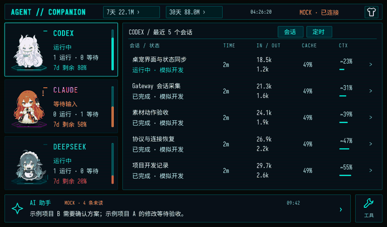

# Agent Companion

把 AI 编程助手的工作进度放到桌面小屏上：三只动态桌宠、最近会话、Token 趋势、额度与余额，以及帮你整理对话的 AI 助手。

本仓库包含 **macOS 控制软件、本机 Gateway、LVGL 模拟器和 ESP32-P4 固件**。当前是 V1 开发预览版，先用模拟器体验，再连接硬件。

## 演示

[](docs/media/demo-0.4.0.mp4)

[观看 MP4 演示](docs/media/demo-0.4.0.mp4) · 录制自 0.4.0 的实际 LVGL 模拟器；0.4.1 已将定时显示控制移至 Mac 开关。使用显著标注的 **MOCK 数据**，不包含真实对话或账号信息。

## 使用说明

需要 Apple Silicon Mac、macOS 13+、Apple Command Line Tools 和 Python 3.9+。工具链脚本会在项目内安装固定版本的 Bun、SDL2、LVGL、Python 依赖与字体。

```bash
git clone https://github.com/kuangda-source/agent-companion.git
cd agent-companion
./scripts/dev setup
./scripts/dev doctor
./scripts/dev build
PORT=8876 ./scripts/dev run --mock
```

构建 Mac 控制软件：

```bash
./scripts/dev mac
open ~/Applications/AgentCompanion.app
```

- **概览**：查看连接状态，打开与板端共用的屏幕预览。
- **AI 助手**：整理最近对话、查看关注事项、追问进展和保存偏好。
- **外观 / 屏幕**：选择赛博霓虹、漫画、新拟物主题；调整亮度与随 Mac 熄屏，并选择是否在会话列表显示定时任务。
- **连接**：首次 USB 配网；同一网络直连 Mac，异地使用自己的云中转。
- **API 设置**：按需填写助手的兼容 API 地址、模型和 Key；填写 DeepSeek 官方 Key 查询余额。

**所有凭据、Wi-Fi、模型地址和远程服务器均不预填。** 会话监控不需要 API Key。AI 助手默认关闭；开启后会向你填写的模型服务发送对话正文节选。密钥保存在 Mac 私有目录，板端与中转不接收模型密钥。

[Mac 配置界面](docs/media/mac-settings.png) · [完整安装与硬件连接](docs/SETUP.md) · [自建中转](docs/RELAY.md) · [开发与已知边界](docs/DEVELOPMENT.md)

支持读取本机 Codex、Claude Code 和 DeepSeek Harness 记录；来源没有记录或字段不可验证时显示未知。普通 Claude Chat 不作为 Code 会话替代。定时对话直接合并到小屏会话列表，同一对话显示最近一条启用计划，运行状态优先，暂停计划不显示。

Token 为本机可读取记录统计，缓存计数包含在输入中，不重复相加；无法保证覆盖其他电脑或已删除记录。DeepSeek 显示 API 账户余额，Codex 额度在运行期间随本地记录快速更新，并每分钟经官方只读接口核对；空闲且剩余低于 20% 时每小时补查，达到 20% 即停止空闲补查。启动、唤醒、新运行轮次、结束及预计重置时间会触发确认；重置时间本身不会把额度改成 100%。

## 让 AI 帮你安装

把下面这段交给你使用的编程助手：

```text
请帮我安装并运行 https://github.com/kuangda-source/agent-companion 。
先阅读 README.md、AGENTS.md 和 docs/SETUP.md，检查我的系统是否满足要求。
按仓库锁定的工具链安装，先运行 PORT=8876 ./scripts/dev run --mock 验证，再构建 Mac 软件。
不要读取或上传我的密钥、Wi-Fi 密码、会话正文和其他项目文件，也不要修改原 Agent 配置。
助手 API、DeepSeek Key 和中转凭据由我在软件界面本机填写，配置留空时跳过可选功能。
有板子时先识别 ESP32-P4 芯片版本、USB 端口和原厂固件备份；先给出具体刷写命令，等我明确确认再刷写，保留 NVS 配网数据。
只报告真实通过的构建与连接结果，明确区分模拟、编译通过和真机验收。
```

## 许可与致谢

自有软件代码使用 [MIT](LICENSE)。随附角色动画为 **CC BY-NC-SA 4.0**，保留 CrossPet、社区设定作者与 clea 的署名；该素材许可包含非商业限制，**不属于 MIT 代码许可**。可替换为你拥有相应授权的原创素材。字体和复用代码各自保留原许可，见 [第三方说明](THIRD_PARTY_NOTICES.md)。项目与 OpenAI、Anthropic、DeepSeek 等公司无官方关联。
