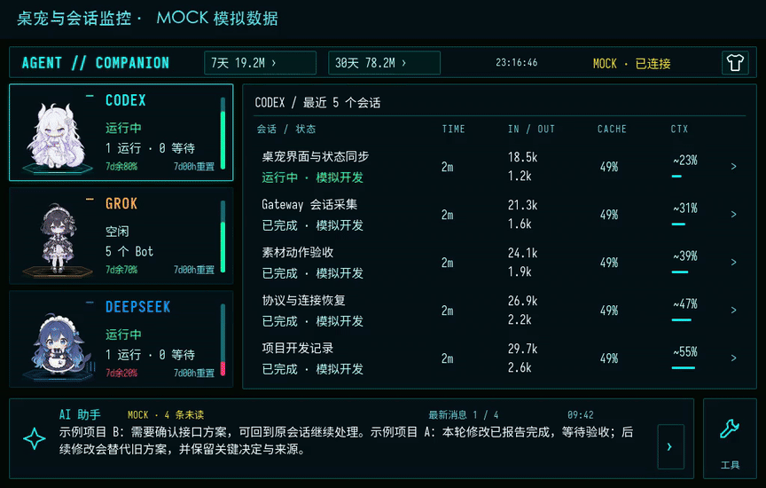

# Agent Companion

把 AI Agent 的进度、最近消息和重要提醒放到桌面小屏上。Mac 负责只读采集与 AI 整理，ESP32-P4 屏幕负责显示动态桌宠、接收触摸操作与播放语音。

本仓库包含 **Mac 控制软件、本机 Gateway、共用的 LVGL 界面、板端固件和可选云中转**。当前是 **V1 开发预览版**；V2 共享场景与实时语音对话后续开发。

## 下载

| 组件 | 当前版本 / 适用设备 | 下载与安装 |
| --- | --- | --- |
| Mac 软件 | **0.4.19** · Apple Silicon / macOS 13+ | [安装包](https://github.com/kuangda-source/agent-companion/releases/download/v0.4.19/AgentCompanion-0.4.19-macos-arm64.zip) · [安装说明](docs/MAC_INSTALL.md) |
| 板端固件 | **0.2.26** · 微雪 ESP32-P4-WIFI6-Touch-LCD-7B，P4 rev3.x，32MB Flash | [固件包](https://github.com/kuangda-source/agent-companion/releases/download/v0.4.19/AgentCompanion-board-0.2.26-esp32p4-rev3x.zip) · [备份与刷写](docs/FIRMWARE_INSTALL.md) |
| 完整源码 | macOS / Gateway / LVGL / ESP32-P4 / Relay | 本仓库 · [开发说明](docs/DEVELOPMENT.md) |

[本次发布与 SHA256 校验文件](https://github.com/kuangda-source/agent-companion/releases/tag/v0.4.19)。Mac 包已包含 Gateway 和屏幕预览，普通运行无需安装开发工具。当前采用临时代码签名，尚未 Apple 公证；Intel Mac 尚未适配。固件已在 P4 rev3.2 验证，不适用于其他芯片或屏幕型号。

## 演示

[](https://github.com/kuangda-source/agent-companion/blob/main/docs/media/demo-0.4.19-overview.mp4)

- [演示一：桌宠与会话 → 详情 → 7/30 天统计 → 三种主题](https://github.com/kuangda-source/agent-companion/blob/main/docs/media/demo-0.4.19-overview.mp4)
- [演示二：屏幕 Wi-Fi 配置 → 音量与静音 → 助手消息](https://github.com/kuangda-source/agent-companion/blob/main/docs/media/demo-0.4.19-tools.mp4)

视频录制自当前版本的实际 LVGL 渲染器，全程标注 **MOCK 模拟数据**，无音轨，不含真实对话、账号、Wi-Fi 或密钥。视频展示软件交互；它不是板子实拍或异地网络验收记录。USB、局域网和中转语音链路另有真机回执验证。

## 首次使用

1. 下载并安装 Mac 软件；没有板子时，也可先用源码运行下方的 MOCK 演示。
2. 有板子时，按 [固件安装说明](docs/FIRMWARE_INSTALL.md) 确认型号与芯片修订、备份原厂 Flash，再刷入配套固件。
3. 打开 Mac 软件，用数据线接入 P4 的 USB 接口。默认 USB 优先，连接页收到屏幕回执后显示已连接。
4. 在 Mac **Agent** 页选择 **1–3 个来源**，默认 Codex / Grok / DeepSeek；Claude Code 可选。找不到记录的来源显示未知。
5. 按需配置以下可选功能；只监控本机记录不需要模型 API Key。

## 配置

**发布包与源码不预填 API Key、Wi-Fi、远程服务器或访问令牌。** 升级保留你已有的本机配置；不要分享 `~/Library/Application Support/AgentCompanion/`。

| 功能 | 在哪里配置 | 需要什么 |
| --- | --- | --- |
| 本机会话监控 | Mac → Agent | 本机相应应用已有记录；原始会话和任务只读 |
| Codex 额度 | 本机 Codex 正常登录 | 使用官方只读额度接口与本地记录，不需要另填推理 Key |
| DeepSeek 余额 | Mac → API 设置 | 自己的 DeepSeek 官方 Key；仅查询余额，不调用推理 |
| AI 助手 | Mac → API 设置 / AI 助手 | 自己的兼容 API 根地址、模型、Key；默认关闭，保存后手动更新或开启自动整理 |
| 语音播报 | Mac → API 设置 / 语音播报 | 单独的 TTS 服务、模型、音色、Key；开启生成与播报，板端需接扬声器 |
| 同一 Wi-Fi 直连 | Mac → 连接，通过 USB 配对 | Mac 与屏幕处于同一网络；不需要云服务器 |
| 异地中转 | [自建中转](docs/RELAY.md)，Mac → 连接 | 自己的 HTTPS/WSS 服务器，分别生成的 Mac / 设备令牌；先通过 USB 下发 |
| 屏幕换 Wi-Fi | 屏幕 → 工具 → Wi-Fi 网络 | 扫描或输入 2.4GHz 网络并保存；已配置中转后，外出换网无需 Mac 在场 |

开启助手会向你指定的模型服务发送必要的对话正文节选；开启 TTS 会发送待播报文本。模型密钥只留在 Mac，不下发给板端或中转。普通 Claude Chat 不作为 Claude Code 记录替代。

[完整配置与连接手册](docs/SETUP.md) · [Mac 安装](docs/MAC_INSTALL.md) · [板端安装](docs/FIRMWARE_INSTALL.md) · [自建中转](docs/RELAY.md)

## 日常操作

- **Agent 卡片**：查看状态、额度与重置倒计时，点选来源。剩余额度大于等于 2/3 为绿色，中间为黄色，小于 1/3 为红色。
- **会话列表**：查看标题、状态与详情。启用的定时任务按会话合并，运行中优先，随后为黄色的下一次计划；暂停计划不显示。是否展示定时任务由 Mac 外观页控制。
- **顶部 7 天 / 30 天**：打开 Token 统计，可切换总体和各 Agent。
- **右上角衣服图标**：弹出主题选择，支持赛博霓虹、漫画、新拟物。
- **底部助手消息**：多行展示最新消息，自动轮播，点击展开；Mac 可查看项目简报、关注事项和搜索历史事件。
- **右下角工具**：Wi-Fi 网络、声音与音量等功能。音量与静音保存在板端，0–100% 对应驱动 0–100 档；响度并非线性变化。
- **语音播报**：待回答、任务结果、重要进展与额度恢复按优先级、去重和静默时段处理。Mac 生成音频，由 USB / 局域网 / 中转连接的屏幕播放。

助手按会话保存读取位置、任务、结果、未解决问题与增量摘要，重要结果、决策和失败原因可检索；不会每轮重复提交完整历史。实时语音唤醒、声纹识别、连续语音对话与完整 Letta 个性化记忆尚未接入。

### 数据边界

Token 是本机可读取记录的统计；缓存计数已包含在输入中，不重复累加，不能保证覆盖其他电脑或已删除记录。DeepSeek 显示 API 余额，不换算成通用剩余 Token。

Codex 额度在运行期间快速跟随本地记录，并每分钟经官方只读接口核对；空闲且剩余低于 20% 时每小时补查。启动、唤醒、状态变化和预计重置时间会触发确认；倒计时到零不直接把额度改成 100%。

Grok Bot 展示本机缓存的 Bot 消息，每 5 分钟刷新可读的每周额度；缓存不提供的实时执行状态、完成事件与 Token 保持未知。Grok 动画已包含在仓库中，未知状态使用轻微 idle 动画。监控不会主动控制 Agent 或修改原始任务。

## 从源码运行

需要 Apple Silicon Mac、macOS 13+、Apple Command Line Tools 和 Python 3.9+。锁定工具链会下载 Bun、SDL2、LVGL、字体和 Python 依赖，首次需要网络及数 GB 空间。

```bash
git clone https://github.com/kuangda-source/agent-companion.git
cd agent-companion
./scripts/dev setup
./scripts/dev doctor
./scripts/dev build
./scripts/dev check
PORT=8876 ./scripts/dev run --mock
```

构建 Mac 软件：

```bash
./scripts/dev mac
open ~/Applications/AgentCompanion.app
```

固件源码构建见 [安装手册](docs/SETUP.md#esp32-p4-7b)。编译不会自动刷写设备。发布打包、脱敏检查和演示录制见 [发布流程](docs/RELEASING.md)。

## 让 AI 帮你安装

把下面这段交给你使用的编程助手：

```text
请帮我安装 https://github.com/kuangda-source/agent-companion 。
先读 README.md、AGENTS.md、docs/MAC_INSTALL.md 和 docs/SETUP.md，检查系统和硬件要求。
普通使用优先下载当前 Release 的 Mac 安装包并核对 SHA256；开发时才安装仓库锁定的工具链，先在独立端口运行 MOCK 验证。
不要读取或上传我的密钥、Wi-Fi 密码、真实会话正文及其他项目，不要修改原 Agent 配置或任务。
API、DeepSeek 余额 Key、TTS 与中转凭据由我在本机界面填写；没有配置时跳过可选功能。
若有板子，先识别具体型号、P4 芯片修订与端口，按 docs/FIRMWARE_INSTALL.md 备份完整 Flash。
给出具体镜像、偏移和刷写命令，等我明确确认后再刷写；不要擦除 NVS 或使用别人带配置的整片镜像。
只报告实际通过的安装、模拟和真机检查，区分三者；不要关闭系统的全局安全检查。
```

## 许可与致谢

自有软件代码采用 [MIT](LICENSE)。**素材不随代码重新许可**：Codex、Claude、DeepSeek 的 CrossPet 衍生角色遵循各自的 **CC BY-NC-SA 4.0** 来源与署名；Grok 新生成角色的参考来源与权利边界单独保留在 [素材说明](assets/pets/grok-v1/license.md)，不作商业清权承诺。可替换为你有相应权利的素材。

感谢 [CrossPet](https://github.com/lokicorvus/crosspet)、社区设定作者、clea 与各开源依赖贡献者。字体和依赖许可见 [第三方说明](THIRD_PARTY_NOTICES.md)。本项目与 OpenAI、Anthropic、DeepSeek、xAI 等公司无官方关联。
