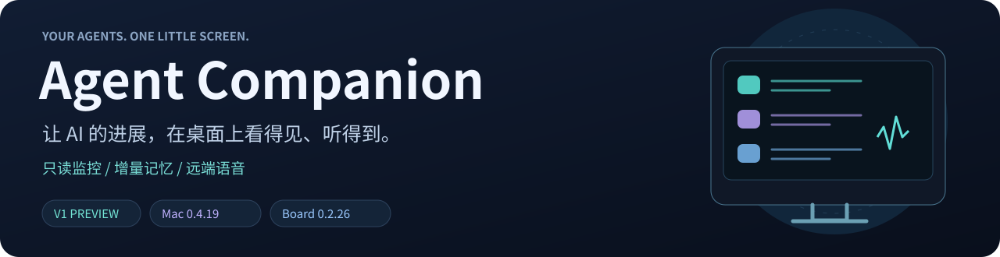
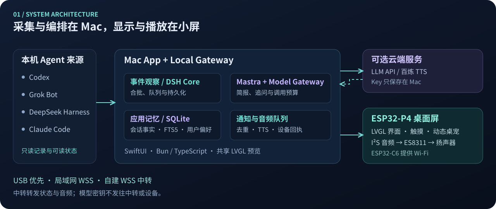
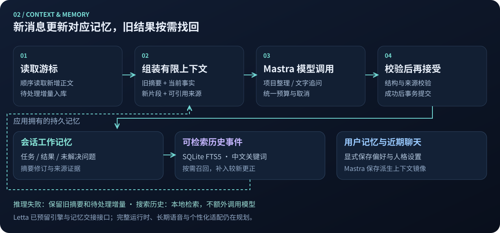
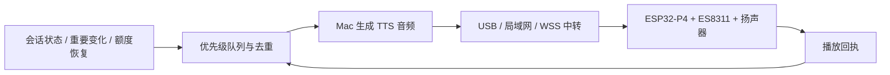

<div align="center">
  
  <p><strong>给忙碌的 AI Agent，一个看得见进度、听得到提醒的桌面搭档。</strong></p>
  <p>
    <a href="https://github.com/kuangda-source/agent-companion/releases/tag/v0.4.19"></a>
    <a href="#下载与快速开始"></a>
    <a href="#使用的硬件"></a>
    <a href="LICENSE"></a>
  </p>
  <p>
    <a href="#演示">演示</a> ·
    <a href="#下载与快速开始">下载</a> ·
    <a href="#ai-助手架构">AI 架构</a> ·
    <a href="#上下文与记忆管理">记忆管理</a> ·
    <a href="#语音助手">语音</a> ·
    <a href="#使用的硬件">硬件</a> ·
    <a href="docs/SETUP.md">安装文档</a>
  </p>
</div>

---

Agent Companion 是一套 **Mac 控制软件 + 本机 Gateway + ESP32-P4 桌面屏**。它读取本机 Agent 的对话与可验证状态，把分散的任务变成桌宠、项目简报和重要提醒。只监控不需要模型 Key；AI 整理和语音合成按需开启。

<table>
<tr>
<td width="33%"><strong>◈ 多 Agent 同屏</strong><br>选择 1–3 个来源，查看最近会话、定时计划、额度与 7/30 天 Token 趋势。</td>
<td width="33%"><strong>✦ 记得项目进展</strong><br>按会话增量整理，保留任务、结果和未解决问题，过去的关键事件可以找回来。</td>
<td width="33%"><strong>♫ 重要消息出声</strong><br>待回答、任务结果、关键进展与额度恢复，由远端屏幕上的扬声器提醒你。</td>
</tr>
<tr>
<td><strong>◇ 桌宠与主题</strong><br>动态角色、状态动作，赛博霓虹 / 漫画 / 新拟物三种主题可选。</td>
<td><strong>⇄ 三种连接</strong><br>USB 优先，也可局域网直连或自建中转；屏幕可独立配置 Wi-Fi。</td>
<td><strong>⌂ 本地管理</strong><br>记录与记忆保存在 Mac，模型密钥不下发设备；原始 Agent 文件只读。</td>
</tr>
</table>

## 演示

<p align="center">
  <a href="https://github.com/kuangda-source/agent-companion/blob/main/docs/media/demo-0.4.19-overview.mp4">
    
  </a>
</p>

| ▶ [监控、统计与主题](https://github.com/kuangda-source/agent-companion/blob/main/docs/media/demo-0.4.19-overview.mp4) | ▶ [Wi-Fi、音量与助手](https://github.com/kuangda-source/agent-companion/blob/main/docs/media/demo-0.4.19-tools.mp4) |
| :--- | :--- |
| 桌宠与会话 → 对话详情 → 7/30 天统计 → 三种主题 | 屏幕配网 → 音量与静音 → 展开助手消息 |

<sub>录制自当前实际 LVGL 渲染器，全部使用标注的 MOCK 模拟数据，无音轨，无真实对话或账号信息；这是软件交互演示，非板子实拍。USB、局域网和中转音频链路另有真机回执验证。</sub>

<a id="首次使用"></a>

## 下载与快速开始

| 组件 | 版本与平台 | 下载 / 文档 |
| :--- | :--- | :--- |
| **Mac 控制软件** | **0.4.19** · Apple Silicon · macOS 13+ | [下载 ZIP](https://github.com/kuangda-source/agent-companion/releases/download/v0.4.19/AgentCompanion-0.4.19-macos-arm64.zip) · [安装说明](docs/MAC_INSTALL.md) |
| **板端固件** | **0.2.26** · Waveshare ESP32-P4-WIFI6-Touch-LCD-7B · rev3.x | [下载固件](https://github.com/kuangda-source/agent-companion/releases/download/v0.4.19/AgentCompanion-board-0.2.26-esp32p4-rev3x.zip) · [备份与刷写](docs/FIRMWARE_INSTALL.md) |
| **完整源码** | macOS / Gateway / LVGL / ESP32-P4 / Relay | [源码构建](#从源码运行) · [开发说明](docs/DEVELOPMENT.md) |

[查看发布说明与 SHA256 校验文件 →](https://github.com/kuangda-source/agent-companion/releases/tag/v0.4.19)

1. **安装 Mac 软件**：解压并打开应用，Gateway 与屏幕预览已经打包。普通使用无需安装 Bun、Python 或编译器。
2. **准备屏幕**：识别型号与 P4 芯片修订，备份自己的原厂 Flash，再按指南刷入配套固件。
3. **接上 USB**：Mac 收到屏幕应用回执后显示已连接；在 **Agent** 页选择 1–3 个来源。
4. **按需启用助手**：填写自己的 API；需要出声时再配置 TTS 并连接扬声器。

> [!NOTE]
> 当前为 V1 开发预览。Mac 使用临时代码签名，尚未 Apple 公证，Intel 尚未适配。发布固件已在 P4 rev3.2 验证，只适用于目标 7B / rev3.x；刷写前请核对自己的硬件与备份。

## AI 助手架构

助手面向“**最近做了什么、有哪些结果、哪些事需要我关注**”。自动整理与手动文字追问共用模型适配和预算管理；模型能力通过你自己的 API 接入。



| 层 | 当前实现 | 负责什么 |
| :--- | :--- | :--- |
| **采集与标准化** | Codex / Grok Bot / DeepSeek Harness / Claude Code 适配器 | 只读本地记录，把会话、状态、用量与来源证据统一为应用协议。 |
| **事件与调度** | DeepSeek **DSH Superagent 事件核心** + 应用自己的持久化适配 | 观察变化、合批、排队、恢复中断的只读整理任务；接入范围是事件核心。 |
| **模型与上下文** | **Mastra Agent** + 本机 Model Gateway | 执行项目简报和文字追问；模型请求统一经过应用预算、取消和调用记录。 |
| **校验与记忆** | 应用自有 **SQLite** + 来源引用校验 | 验证输出结构和项目／会话归属后，提交摘要、结构化事实、历史事件与关注项。 |
| **通知与展示** | 本地通知 / 语音队列 + SwiftUI / LVGL | 把重要变化展示在 Mac 和屏幕上，按优先级准备播报并追踪设备回执。 |

**更新由变化触发，观察由轻量轮询完成。** 每 15 秒检查本地来源，有变化才进入事件队列；30 秒静默窗口或 2 分钟合并窗口之后，仍按冷却、每日预算和可用性调度。待回答／异常优先，无变化不重复请求模型；手动更新可立即发起一次整理。模型失败时保留已有简报并逐步退避。

模型结果始终带来源约束：区分 **计划 → 来源报告 → 验证 → 用户验收**，旧待办和历史错误不直接当作当前状态。自动化执行范围限定为本地整理、存储和提醒。

<details>
<summary><strong>实现入口与开源组件</strong></summary>

- [来源采集](apps/gateway/src/assistant-source.ts) · [DSH 调度适配](apps/gateway/src/assistant-events.ts) · [上游核心与固定版本](packages/dsh-superagent-core/README.md)
- [Mastra 适配](apps/gateway/src/assistant-mastra.ts) · [模型调用边界](apps/gateway/src/assistant-model-gateway.ts) · [助手主流程](apps/gateway/src/assistant.ts)
- DSH 复用自 [DeepSeek Superagent](https://github.com/deepseek-ai/dsh-superagent-prototype) 的核心，未引入上游 Harness 运行时、Shell 执行器或外部消息写入通道。
- Mastra 用于当前运行；Letta 的引擎和记忆交接接口已预留，完整 Letta 运行时尚未接入。

</details>

## 上下文与记忆管理

**增量摘要维持近况，可搜索的历史事件补回细节。** 会话历史再长，也按读取位置分批摄取；不在每轮把全部历史重新交给模型。



| 记忆层 | 保存的内容 | 如何使用 |
| :--- | :--- | :--- |
| **读取游标与增量收件箱** | 每个会话最后读取位置、尚未成功归纳的正文片段、已消费回执 | 新消息只进入对应会话；摘要失败不丢弃待处理增量。 |
| **会话工作记忆** | 当前任务、最新结果、未解决／已解决问题、滚动摘要及修订 | 每轮提交旧摘要、相关事实和新增片段，只更新受影响部分。 |
| **历史事件记忆** | 重要实验结果、决策、失败／阻塞、解决记录、里程碑与历史摘要 | **SQLite FTS5** 中文关键词检索，保留时间、来源和验证阶段；没有额外安装 Claude-Mem 观察器。 |
| **近期助手对话** | 应用接受的用户消息与助手回复 | Mastra 以 **32k Token 的消息历史预算**管理近期聊天，项目资料另行裁剪；这不是每次必发的用量，也不是整个模型输入上限。 |
| **显式用户记忆** | 用户主动保存的偏好、可修改的人格与语气、记忆版本和删除标记 | 用户控制记住／忘记什么；人格影响表达，不覆盖项目事实与引用规则。 |

**应用数据库是记忆的权威来源。** Mastra 的 LibSQL 存储是派生的上下文镜像，调用前从已接受记录重建；项目事实与个人偏好分开管理。已预留身份、版本、导入／导出和遗忘校验接口，便于后续适配 Letta。

追问过去的实验时，先做本地检索，再选入 **最多 6 条相关历史事件**及少量原文，并补入同主题较新的更正或解决记录。手动搜索不调用模型、不消耗 API Token；追问会把选中的内容加入当次模型输入。当前是关键词检索，向量语义召回尚未接入。

<details>
<summary><strong>上下文限额、失败恢复与覆盖范围</strong></summary>

- 默认关注近 7 天、最多 8 个会话，可配置至近 30 天、16 个会话；界面会说明实际已读和待处理范围。
- 每批最多归纳 2 个会话，特定百炼 Qwen 配置按单会话处理；旧摘要、结果、问题和原文都有长度限制，剩余积压继续保存在本地。
- 简报与追问共用每日请求预算：默认 48 次，可配置为 1–200 次。这是请求次数上限，不是固定 Token 花费。
- 摘要、来源引用、会话记忆和历史索引在事务中提交；无效输出保留旧记忆与增量，已成功处理的其他会话不被回滚。
- 索引来自应用已经读取、校验并接受的内容，不代表完整历史已经摄取。来源时间、当时状态和较新修正会一起参与回答。
- [会话记忆](apps/gateway/src/session-memory.ts) · [历史检索](apps/gateway/src/assistant-history.ts) · [用户记忆](apps/gateway/src/assistant-user-memory.ts) · [后端交接协议](apps/gateway/src/assistant-memory-contract.ts)

</details>

## 语音助手

### V1：重要信息播报

Mac 整理信息、生成音频，**声音在监视器端播放**。Mac 放在宿舍、屏幕放在工位时，只要主机持续运行并联网，就可以通过自建中转接收播报。



| 事件 | 播报行为 |
| :--- | :--- |
| **等待用户回答或确认** | 高优先级提醒；等待解除后取消尚未播放的提示。 |
| **重复工具错误 / 重要阻塞** | 高优先级提醒；同一错误周期连续失败只报一次，恢复或实质变化后重新判断。 |
| **一轮对话结束** | 等待 20 秒合并可用的简要结果，避免“结束”和“结果”接连重复播报。 |
| **重要进展与决策** | 仅播报有来源的重要变化，保留“来源报告／验证结果／已验收”的区别。 |
| **额度恢复** | 依据新的、可确认的额度数据提醒；倒计时到零本身不代表官方已重置。 |

- **声音来源**：支持 Mac 系统语音、阿里云百炼 TTS；可配置模型与音色。系统语音也会生成音频送往设备。
- **播放控制**：播报类别、全局静音、安静时段、停止和手动重播；屏幕 **工具 → 声音与音量** 支持 0–100% 音量与本地静音，重启保留。
- **打扰控制**：首次启用建立基线，不补播旧历史；事件带有效期，实际播放结束后至少间隔 15 秒。
- **投递可靠性**：音频带长度、分块 CRC 和整体 SHA256 校验，设备返回播放结果；回执不明时显示待确认，不自动重播。

<details>
<summary><strong>音频链路与配置</strong></summary>

当前传输格式为 **16kHz、单声道、PCM16**，单段最长 30 秒。Mac 保存必要的音频缓存，板端按需初始化播放器。TTS 生成与语音播报是两个独立开关，均开启后才自动准备播报。

模型 Key 保存在 Mac；设备和中转接收音频及投递信息。云端 TTS 接收待合成的文本，使用前需配置自己的服务。

[配置与操作](docs/SETUP.md#可选-api) · [播报队列](apps/gateway/src/voice-broadcast.ts) · [TTS 适配](apps/gateway/src/speech-provider.ts) · [板端播放](apps/device/main/ac_audio.c)

</details>

### 后续：语音输入与连续对话

语音唤醒、声纹识别、语音识别（ASR）、连续对话和打断尚未接入。已预留语音轮次、取消、播放位置回执和记忆后端接口；完整 Letta 适配安排在长期语音对话与个性化阶段。板载麦克风是硬件资源，不等同于上述软件功能已经可用。

## 使用的硬件

| 部分 | 当前使用 | 在项目中的作用 |
| :--- | :--- | :--- |
| **主机** | Apple Silicon Mac，macOS 13+ | 本地来源采集、控制界面、助手推理请求、记忆与 TTS 音频生成。 |
| **桌面屏主板** | **Waveshare ESP32-P4-WIFI6-Touch-LCD-7B**，本次固件面向 P4 rev3.x | P4 运行 ESP-IDF / FreeRTOS 与 LVGL，处理显示、触摸和音频播放。 |
| **屏幕与触摸** | 7 英寸 IPS，**1024 × 600**，MIPI-DSI；GT911 电容触摸 | 动态桌宠、会话列表、助手消息和工具入口。 |
| **存储** | **32MB NOR Flash + 32MB PSRAM** | 固件、图像资源、运行缓冲与音频缓冲。 |
| **无线协处理器** | ESP32-C6-MINI-1，通过 SDIO / ESP-Hosted | 2.4GHz Wi-Fi 6，供局域网与异地中转连接使用。 |
| **语音输出** | 板载 **ES8311** 音频 Codec，外接扬声器接 **SPK** | 从小屏发声；仅使用屏幕显示时可不接扬声器。 |
| **麦克风资源** | 板载双麦克风与 **ES7210** 音频 ADC | 后续语音输入资源；V1 播报不依赖麦克风。 |
| **数据与供电** | P4 USB 数据接口、可传数据的 USB 线、稳定供电 | 首次刷写、配网、配对和默认 USB 同步；以商家供电规格为准。 |
| **可选中转** | 自备 Linux 服务器 + HTTPS/WSS，参考 Ubuntu / Nginx 部署 | 异地转发状态与音频；USB 和同一局域网使用不需要服务器。 |

[微雪官方硬件说明](https://github.com/waveshareteam/ESP32-P4-WIFI6-Touch-LCD-7B#hardware-overview) · [官方使用文档](https://docs.waveshare.com/ESP32-P4-WIFI6-Touch-LCD-7B) · [固件安装与备份](docs/FIRMWARE_INSTALL.md) · [自建中转](docs/RELAY.md)

锁定工具链：ESP-IDF **5.5.5**、Waveshare BSP **3.0.1**、LVGL **9.5.0**。屏幕 UI 与 Mac 预览共用 LVGL 代码。摄像头、microSD、RTC、电池及扩展总线均不是当前基础功能的必需配件。

## 配置与日常使用

**源码和发布包不预填 API Key、Wi-Fi、远程服务器或访问令牌。** 个人配置保存在本机 `~/Library/Application Support/AgentCompanion/`，普通升级会保留。

| 功能 | 配置入口 | 需要什么 |
| :--- | :--- | :--- |
| 本机会话监控 | Mac → Agent | 本机已有记录，选择 1–3 个来源；默认 Codex / Grok / DeepSeek，Claude Code 可选。 |
| Codex 额度 | 本机 Codex 登录态 | 官方只读额度与本地记录，无需另填推理 Key。 |
| DeepSeek 余额 | Mac → API 设置 | 自己的 DeepSeek 官方 Key，仅用于余额查询。 |
| AI 助手 | Mac → API 设置 / AI 助手 | 自己的兼容 API 根地址、模型和 Key；默认关闭。 |
| 语音播报 | Mac → API 设置 / 语音播报 | 选择 TTS，配置云端服务时填写自己的模型、音色和 Key；开启生成与播报。 |
| 同一 Wi-Fi 直连 | Mac → 连接，通过 USB 配对 | 主机与屏幕位于同一网络。 |
| 异地中转 | Mac → 连接 | 自建 WSS 地址与分别生成的 Mac / 设备令牌，首次通过 USB 下发。 |
| 屏幕换 Wi-Fi | 屏幕 → 工具 → Wi-Fi 网络 | 扫描或输入网络并保存；已配置中转后，换网无需 Mac 在场。 |

开启助手会将必要的对话正文节选发送到你指定的模型服务；开启云端 TTS 会发送待播报文本。普通 Claude Chat 不作为 Claude Code 记录替代。

<details>
<summary><strong>屏幕上怎么操作</strong></summary>

- **左侧角色卡片**：切换 Agent、查看状态和额度；剩余大于等于 2/3 为绿色，中间为黄色，小于 1/3 为红色。
- **会话列表**：点击查看详情。启用计划按会话合并，运行中优先，随后显示黄色的下一次定时；暂停计划不显示。显示开关在 Mac 外观页。
- **顶部 7 天 / 30 天**：展开 Token 图表，可选总体或各 Agent。
- **衣服图标**：弹出主题选择窗口。
- **底部助手消息**：多行轮播最新消息，点击展开更多内容。
- **工具**：独立 Wi-Fi 配网、声音与音量等功能；Mac 屏幕设置还可控制亮度和随主机熄屏。

</details>

<details>
<summary><strong>用量、额度与 Bot 状态怎么算</strong></summary>

Token 统计来自本机可读取记录；缓存计数已包含在输入中，不重复累加，无法保证覆盖其他电脑或已删除记录。DeepSeek 显示 API 余额，不换算成通用剩余 Token。

Codex 运行期间快速跟随本地记录，每分钟经官方只读接口核对；空闲且剩余低于 20% 时每小时补查。启动、唤醒、状态变化和预计重置时间会触发确认。

Grok Bot 仅展示本地已缓存消息，每 5 分钟刷新可读的每周额度；来源未提供的实时执行状态、完成事件和 Token 保持未知。未知状态使用轻微 idle 动画。

</details>

[完整安装与配置手册 →](docs/SETUP.md)

## 从源码运行

需要 Apple Silicon Mac、macOS 13+、Apple Command Line Tools 和 Python 3.9+。锁定工具链会下载 Bun、SDL2、LVGL、字体与依赖，首次需要网络及数 GB 空间。

```bash
git clone https://github.com/kuangda-source/agent-companion.git
cd agent-companion
./scripts/dev setup
./scripts/dev doctor
./scripts/dev build
./scripts/dev check
PORT=8876 ./scripts/dev run --mock
```

构建 Mac 软件：

```bash
./scripts/dev mac
open ~/Applications/AgentCompanion.app
```

[固件源码构建](docs/SETUP.md#esp32-p4-7b) · [开发边界](docs/DEVELOPMENT.md) · [发布、脱敏与演示录制](docs/RELEASING.md)

<details>
<summary><strong>复制给你的 AI：安装提示词</strong></summary>

```text
请帮我安装 https://github.com/kuangda-source/agent-companion 。
先读 README.md、AGENTS.md、docs/MAC_INSTALL.md 和 docs/SETUP.md，检查系统和硬件要求。
普通使用优先下载当前 Release 的 Mac 安装包并核对 SHA256；开发时才安装锁定工具链，先在独立端口运行 MOCK 验证。
不要读取或上传我的密钥、Wi-Fi 密码、真实会话正文及其他项目，不要修改原 Agent 配置或任务。
API、DeepSeek 余额 Key、TTS 与中转凭据由我在本机填写；没有配置时跳过可选功能。
若有板子，先识别具体型号、P4 芯片修订与端口，按 docs/FIRMWARE_INSTALL.md 备份完整 Flash。
给出具体镜像、偏移和刷写命令，等我明确确认后再刷写；不要擦除 NVS 或使用别人带配置的整片镜像。
只报告实际通过的安装、模拟和真机检查，区分三者；不要关闭系统的全局安全检查。
```

</details>

## 开发路线

| 当前 V1 已实现 | 后续规划 |
| :--- | :--- |
| 多 Agent 监控、动态桌宠与三种主题 | **语音交互**：唤醒、ASR、声纹、连续对话与打断 |
| 增量项目简报、文字追问、历史事件检索 | **长期个性化**：完整 Letta 适配与语音记忆协作 |
| USB / 局域网 / 中转，设备端重要信息播报 | **V2 共享空间**：三渲二场景、角色拖放、角色与环境互动 |

V1 继续完善功能与美术后，再推进 V2；共享空间尚未替换当前卡片界面。

## 许可与致谢

自有软件代码采用 [MIT](LICENSE)。角色素材适用各自许可：Codex、Claude、DeepSeek 的 CrossPet 衍生资源遵循 **CC BY-NC-SA 4.0** 的来源与署名；Grok 新生成角色的参考来源与权利边界见 [素材说明](assets/pets/grok-v1/license.md)，不作商业清权承诺。可替换为你有相应权利的素材。

感谢 [CrossPet](https://github.com/lokicorvus/crosspet)、社区设定作者、clea、[Mastra](https://github.com/mastra-ai/mastra)、[DeepSeek Superagent](https://github.com/deepseek-ai/dsh-superagent-prototype)、LVGL、ESP-IDF 与 Waveshare 等贡献者。字体、依赖和素材的完整许可见 [第三方说明](THIRD_PARTY_NOTICES.md)。本项目与 OpenAI、Anthropic、DeepSeek、xAI 等公司无官方关联。
